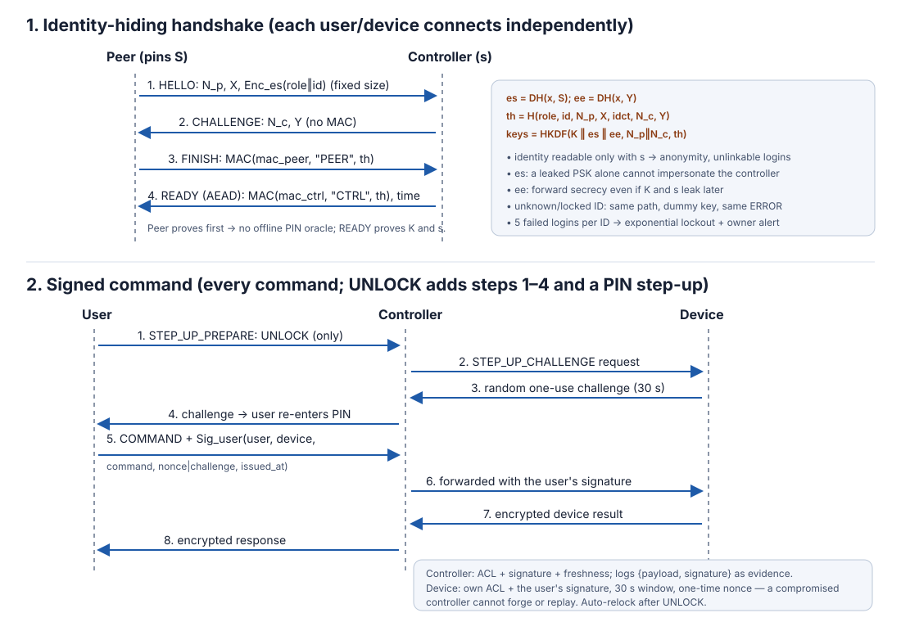

# Protocol Specification (smarthome-v2)

## 1. Notation

| Symbol | Meaning |
|---|---|
| `P` | the connecting peer: a user (`role=user`) or a device (`role=device`) |
| `C` | the controller (home gateway) |
| `K` | long-term 256-bit PSK shared by `P` and `C` (`K_UC` or `K_CD`) |
| `s`, `S = g^s` | the controller's long-term static X25519 key pair; `S` is pinned in every peer's config |
| `N_p`, `N_c` | fresh 128-bit random nonces from `P` and `C` |
| `x`, `X = g^x` | ephemeral X25519 key of `P` (`y`, `Y` for `C`) |
| `es = DH(x, S) = DH(s, X)` | static-ephemeral shared secret: only the real controller can compute it |
| `ee = DH(x, Y)` | ephemeral-ephemeral shared secret: forward secrecy |
| `th` | transcript hash `SHA256(PROTO, role, id, N_p, X, idct, N_c, Y)` |
| `MAC(k, ...)` | HMAC-SHA256 over an unambiguous length-prefixed (TLV) encoding |
| `Enc_k(m)` | AES-256-GCM |
| `Sig_u(m)` | Ed25519 signature by user `u` |

## 2. Phase 1: identity-hiding mutual authentication + key agreement

The same handshake is used for user-to-controller and device-to-controller connections.

```
        Peer P                                                 Controller C (s)
  x fresh, es = DH(x, S)
  idct = Enc_{HKDF(es)}(role || id, padded to 96 bytes)
          |  1. HELLO {N_p, X, idct}                               |
          |------------------------------------------------------->|  es = DH(s, X); open idct
          |                                                        |  look up K (dummy if unknown)
          |  2. CHALLENGE {N_c, Y}                 (no MAC!)       |
          |<-------------------------------------------------------|
  ee = DH(x, Y)                                         ee = DH(y, X)
  (mac_peer, mac_ctrl, k_p2c, k_c2p) = HKDF-SHA256(ikm  = K || es || ee,
                                                   salt = N_p || N_c,
                                                   info = "smarthome-v2" || "key schedule" || th)
          |  3. FINISH {MAC(mac_peer, "PEER", th)}                 |
          |------------------------------------------------------->|  verify => P knows K and x
          |  4. READY {MAC(mac_ctrl,"CTRL",th), controller_time,   |
          |            limits}   (Enc_{k_c2p}, seq 1)              |
          |<-------------------------------------------------------|
  verify => C knows K AND s
```

Design points and why each exists:

* **Identity hiding (user anonymity + untraceability).** `role` and `id` never cross the
  network in clear text. They are encrypted under a key derived from `es`, which only the
  holder of `s` can compute. The plaintext is padded to a fixed size, so its length reveals
  nothing. Because `x` is fresh every time, two logins by the same user produce unrelated
  HELLOs (demo scenario 11; ProVerif query `attacker(good_id)`).
* **Two-factor controller authentication.** `READY` can only be produced by someone who knows
  `K` **and** `s`. A leaked PSK alone does not let an attacker impersonate the controller
  (demo scenario 12; ProVerif "stronger attacker" variant).
* **Peer proves first, so there is no offline PIN-guessing oracle.** `CHALLENGE` carries no
  `K`-dependent value. An attacker holding a stolen PIN-wrapped config (§4) learns only
  accept/reject for one PIN guess per online handshake, and the controller throttles those
  per identity. Because `es` is in the key schedule, a passive recording of an honest
  handshake gives no test either (ProVerif `weaksecret pin`). In v1 the controller sent a
  MAC in message 2, which made offline guessing possible. The ProVerif variant
  "controller proves first" finds that attack.
* **Mutual authentication with transcript binding.** Both MACs, and all keys, depend on the full
  transcript hash `th`. That covers both nonces, both ephemeral keys, the encrypted identity
  and the decrypted identity.
* **Reflection resistance.** The distinct labels `"PEER"`/`"CTRL"`, separate MAC keys, and
  per-direction session keys with the direction in the AAD.
* **Forward secrecy.** `ee` is ephemeral, so recorded sessions stay secret even if `K`
  **and** `s` leak later (ProVerif phase-1 leak of both).
* **No user enumeration.** An unknown, locked or undecryptable identity follows the identical
  path with a random dummy key and fails only at FINISH with the same `ERROR`.
* **Key confirmation and clock sync.** `READY` is the first AEAD message (seq 1). Its
  timestamp is not checked against the peer's clock; the peer adopts `controller_time` as the
  offset for all later freshness checks.

## 3. Phase 2: secure messages (`Channel`)

Every post-handshake message is one fixed-size encrypted payload:

```
{"type":"DATA", "seq": n, "ct": hex(AES-256-GCM(key_dir,
    nonce = n as 12 bytes, plaintext = length || JSON || random padding to 1024 bytes,
    AAD = direction_label || n))}
```

The receiver checks, in order:

1. the GCM tag is valid (otherwise `TamperError`)
2. `seq` > last accepted (otherwise `ReplayError`)
3. `seq` == last + 1 (otherwise a message was dropped, which is an error)
4. `|controller_time_now - ts| <= 30 s` (otherwise `StaleError`)

The (key, nonce) pair is never reused: keys are per session and per direction, and the nonce
is the counter. A user session expires after 15 minutes, five idle minutes, or 10,000 messages;
the client then re-handshakes.

## 4. User secrets at rest (stolen-device / stolen-config resistance)

The user's config file holds no plaintext secret and nothing that can verify a PIN:

```
wrapped_secrets = (K || ed25519_seed) XOR Scrypt(PIN, salt, N=2^15, r=8, p=1, 64 bytes)
```

* There is no authentication tag, and the signing public key is not stored in the file. Every
  PIN guess unwraps to a well-formed 32-byte PSK and a valid Ed25519 key, so the file alone
  cannot confirm a guess.
* The PIN is required at login (to unwrap `K`) and again for `UNLOCK` (step-up, compared in
  constant time with the in-memory secrets).
* **Online guessing defence:** after 5 consecutive failed handshakes for a known identity the
  controller locks that identity for 1 s, then 2 s, 4 s … (max 300 s). It raises an owner alert
  `AUTH_GUESSING`. During the lock even the right PIN is refused, and the response is identical
  to a wrong key. A successful login resets the counter.
* Device PSKs stay in device config files. A real device would keep them in a secure element.

## 5. Signed commands: end-to-end authenticity and non-repudiation

Every command, not only `UNLOCK`, carries the user's Ed25519 signature:

```
payload   = JSON{proto, user_id, device_id, command, nonce, issued_at}   (canonical, sorted keys)
COMMAND   = {..., nonce, issued_at, signature = Sig_u(payload)}
```

| Check | Controller | Device |
|---|---|---|
| Signature valid for the user's key | always | when the user's key was pinned at provisioning |
| `issued_at` within 30 s of controller time | yes | yes (device clock synced via READY) |
| `nonce` one-time | (channel sequence numbers) | yes, cache of recent nonces |
| `UNLOCK`: nonce is the device-issued one-use challenge | forwarded | yes, consumed even if the signature is invalid |

* **Non-repudiation.** The controller stores `{payload, signature}` with every forwarded
  command in the hash-chained audit log. `python controller.py --verify-audit` re-verifies
  each signature against the users' public keys. The controller never holds user private
  keys, so it cannot fabricate this evidence, and an insider who edits a logged command
  invalidates its signature (demo scenario 14).
* **A compromised controller cannot forge or replay commands for users with pinned keys.** The
  device verifies the user's own signature and nonce (demo scenario 13). It can still deny
  service, and it can still issue commands for users enrolled after provisioning (no pinned
  key; `UNLOCK` is never possible for them).

`UNLOCK` step-up: the user requests a challenge, and the device returns a random one-use
challenge valid for 30 s (at most 5 per user per minute). The user re-enters the PIN and signs
with `nonce = challenge`. Accepted and rejected unlocks notify the owner, and the device
auto-relocks after 30 s.

## 6. Enrollment and key rotation

* **Enrollment.** The owner's local console issues a **pairing code** = one-use 256-bit token ||
  controller static public key `S`, valid for five minutes. The new user runs the normal v2
  handshake with the token as `K` and the pinned `S` from the code, then sends a fresh PSK and
  an Ed25519 public key inside the encrypted session. The new config is written PIN-wrapped.
* **Rotation.** `KEY_ROTATE` inside an authenticated session, after the user re-enters the PIN.
  The new PSK is re-wrapped under the same PIN with a fresh salt.
* **Revocation.** It removes the record, closes the live session and pushes new allow-lists to
  the devices.

## 7. Application messages

User -> Controller (inside the channel):
```json
{"type":"COMMAND","user_id":"hari","device_id":"light1","command":"TURN_ON",
 "nonce":"9f…","issued_at":1760000000,"signature":"a1…","ts":1760000000}
```
Controller -> Device:
```json
{"type":"COMMAND","device_id":"light1","command":"TURN_ON","on_behalf_of":"hari",
 "nonce":"9f…","issued_at":1760000000,"signature":"a1…","ts":1760000001}
```
Device -> Controller -> User:
```json
{"type":"RESPONSE","status":"OK","detail":"LIGHT TURNED ON","state":"ON","ts":1760000001}
```
Status values: `OK`, `DENIED` (ACL/signature), `ERROR` (offline / unsupported / malformed).

## 8. Authorization (two layers)

1. **Controller ACL**: `users.<id>.allowed.<device> = [commands]`. The `user_id` in a message
   must equal the authenticated session user.
2. **Device ACL**: `allowed_users`, `allowed_commands` (pushed by the controller with
   `UPDATE_AUTHZ`), plus the pinned signing keys, which the controller cannot replace. The
   device fails closed when a list is missing.

## 9. Failure handling

* Handshake failure: generic `ERROR "authentication failed"`, then the connection closes. The
  failure counts toward the per-IP cooldown and, for a known identity, the per-identity backoff.
* Any `TamperError`, `ReplayError`, `StaleError` or protocol violation terminates the session
  and is logged (`TAMPER`, `REPLAY`, `STALE`, `PROTO_ERROR`). The design fails closed.

## 10. Security properties and evidence

| Property | Mechanism | Evidence |
|---|---|---|
| Mutual authentication | PSK + DH key schedule, FINISH MAC, READY confirmation | ProVerif Q1/Q2; demo 5–7 |
| Controller auth survives PSK leak | `es` requires the static key `s` | ProVerif stronger-attacker variant; demo 12 |
| Session key secrecy + forward secrecy | `ee`, HKDF over the transcript | ProVerif (PSK and `s` leaked later) |
| User anonymity / untraceability | identity encrypted under `es`, fixed size, fresh per login | ProVerif `attacker(good_id)`; demo 11 |
| Stolen config gives no offline PIN guessing | tagless wrap, peer proves first, `es` in keys | ProVerif `weaksecret pin`; demo 15 |
| Online guessing limited | per-identity exponential backoff + owner alert | demo 15; lockout test |
| Confidentiality / integrity | AES-256-GCM, fixed 1024-byte payloads | demo 2, 4 |
| Replay / reflection / deletion | sequence numbers, direction AAD, gap detection | demo 3, 10 |
| Delay | 30 s timestamp window (channel and signed command) | demo 9 |
| End-to-end command authenticity | Ed25519 per command, verified by the device | demo 13 |
| Non-repudiation | signed evidence in the audit log, re-verifiable | demo 14; `--verify-audit` |
| Authorization | controller ACL + device ACL + `UNLOCK` step-up | demo 8 |
| DoS limits | connection cap, pre-auth timeout, per-IP cooldown | controller tests |


